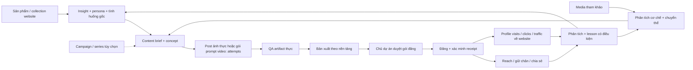

# Cấu trúc hệ thống Errare Club

Version workspace 0.2.0 · 2026-10-20 · Bảy skill hướng dẫn + helper nguồn đã triển khai; chưa có engine render/publish tự động. Media contract giữ 0.1.4.

## Phạm vi đã chốt

Theo [SCOPE](07-Operations/SCOPE.md), hệ thống tập trung media và kênh social. R&D sản phẩm ở bộ phận khác; Drive trong [PRODUCT-SOURCES](01-Brand/PRODUCT-SOURCES.md) là hồ sơ chính, website là nguồn bổ sung read-only. Nghiên cứu đối thủ theo [SOCIAL-RESEARCH](02-Research/SOCIAL-RESEARCH.md). Tám cast cũ không còn là roster bắt buộc; được xây lại nhân vật.

## Hai gói đầu ra đã chốt

Post ảnh: file ảnh thực đủ target size/placement + caption en-US với 3–5 hashtag. Video: một frame pair prompt cho hai ảnh riêng first=t0/last=duration_s + video prompt + caption; mặc định là prompt package, không tự render. Single/carousel là layout ảnh; không giữ text-only làm gói sản xuất riêng mặc định. Chuẩn ở [media-contract](00-Standards/media-contract.json) và [OUTPUT-CONTRACT](04-Productions/OUTPUT-CONTRACT.md). Skill theo [đề xuất](07-Operations/SKILLS.md), cùng đọc nguồn theo [SOURCE-ROUTING](00-Standards/SOURCE-ROUTING.md), không copy CSDL vào từng skill.

Toàn creative hướng audience Mỹ theo [US-AUDIENCE](00-Standards/US-AUDIENCE.md). Visual mặc định như điện thoại đời thường; video do người cầm điện thoại, góc/rung hợp cảnh, cinematic chỉ khi yêu cầu theo [PHONE-MEDIA](00-Standards/PHONE-MEDIA.md). Ảnh tạo/sửa bằng Codex ImageGen, không tự chuyển provider.

## Quyết định kiến trúc

Chọn một workspace theo thương hiệu, tổ chức sản xuất bằng Content → Attempt; Campaign/series là nhóm tùy chọn, không chặn content độc lập. Hai đầu vào product/reference (hoặc hybrid) cùng dùng lõi theo [INTAKE](02-Research/INTAKE.md) và [production guide](04-Productions/README.md). Table, cast, format và platform là các chiều tham chiếu. Một nội dung có thể liên quan nhiều Table; một campaign có nhiều định dạng; một bản master có nhiều bản xuất và nhiều bài đăng.

Không nhân bản Errare thành mười project độc lập. Cách đó dễ làm trôi mặt, khác giọng, chia nhỏ lịch sử và khó biết cùng một sản phẩm đang được quảng bá ở đâu. Không dùng account mạng xã hội làm thư mục sản xuất. Đổi kênh không đổi Content ID.

MVP dùng Markdown cho hướng dẫn và JSON cho record có cấu trúc. Một người/AI ghi dữ liệu tại một thời điểm. Khi có scheduler hoặc hai worker ghi đồng thời, chuyển trạng thái công việc, ngân sách, khóa và idempotency sang SQLite transactional; khi có nhiều máy ghi trực tiếp mới cân nhắc dịch vụ database chung. Không duy trì hai nguồn trạng thái ngang quyền.

## Bản đồ thư mục

```text
AGENTS.md, README.md, SYSTEM.md       Điểm vào gọn, nguồn hiện hành
.agents/skills/er-*/                  Bảy skill + metadata UI, đọc nguồn chung
00-Standards/                       Workflow, QA, hợp đồng, lưu trữ
01-Brand/                           Brand, Table, cast, địa điểm, sản phẩm
02-Research/                        Intake product/reference, social research, model profiles
03-Campaigns/                       Mục tiêu, danh mục nội dung, thí nghiệm
04-Productions/                     Lõi sản xuất, output contract, templates; runtime private
05-Distribution/                    Channel registry, adapter, quy tắc release/post
06-Insights/                        Định nghĩa đo lường, phân tích, bộ nhớ
07-Operations/                      Quyết định, rollout, vận hành
08-Evaluation/                      QA thiết kế và kiểm cấu trúc
scripts/                           Validator cấu trúc, helper nguồn và tests offline
.errare/                           Runtime riêng khi phát sinh, không public
```

Thư mục rỗng hoặc module tương lai không được tạo chỉ để đầy cây. README từng khu vực mô tả hồ sơ phát sinh khi có việc thật.

## Luồng khép kín



Product mode đi thẳng từ sản phẩm đến concept, không cần mẫu viral hoặc watchlist. Reference mode được phân tích mẫu trước khi chọn sản phẩm; hybrid kết hợp hai nguồn. Một Content có thể standalone hoặc gắn Campaign. Sản phẩm thật và trang đích đi vào khi nội dung cần dùng; không tự bịa sản phẩm để khớp mẫu. Một post có mục tiêu awareness vẫn có thể dẫn về Table; không ép mọi bài thành quảng cáo trực tiếp.

## Nguồn duy nhất

| Thông tin | Nguồn chính | Quy tắc |
|---|---|---|
| Giọng/luật brand | BRAND.md | Brief riêng không tự sửa luật lâu dài |
| Table/location và cast cũ | JSON trong 01-Brand | Seed nguồn; roster mới được xây lại và version riêng |
| Hồ sơ/câu áo/hình sản phẩm | Kho Drive được chỉ định, cache snapshot local | products.json là seed lịch sử; website bổ sung thông tin đang công bố, không tự thay hồ sơ Drive |
| Giá/offer nếu caption cần | Thông tin website công bố | Không quản lý R&D hoặc tồn kho; chỉ kiểm claim liên quan |
| Concept/chuyện đã chọn | Content record | Lưu entry_mode/task/format độc lập, campaign tùy chọn |
| Prompt/input/output thật | Attempt | Planned input khác actual input |
| Media chuẩn để xuất | Selection có hash | Không dùng quy tắc file mới nhất |
| Gói được duyệt | Approval theo release digest | Sửa gói làm hết hiệu lực duyệt |
| Bài đã đăng | Receipt + native post ID | Upload timeout chưa chứng minh thất bại |
| Metrics | Snapshot nguồn + thời điểm | Dashboard/index là bản dựng lại |
| Bài học | Lesson candidate/active/retired | Active không được ghi đè brand |

## Vai trò vận hành

| Vai trò | Trách nhiệm | Điểm bàn giao |
|---|---|---|
| Chủ dự án | Chốt ưu tiên, ngân sách, duyệt phát hành | Quyết định cụ thể có phiên bản |
| Planner/creative | Insight, concept, độ mới, giả thuyết | Brief đủ để sản xuất |
| Producer | Prompt, generation, edit, export | Artifact thật + provenance + chi phí |
| Reviewer | Đối chiếu artifact với brief/checklist | Báo cáo có lỗi, vị trí, phạm vi đã xem |
| Publisher | Preflight, lịch đăng, receipt | Native post ID/URL, trạng thái xác minh |
| Analyst | Phân tích media/kênh và traffic; nhận feedback mua hàng nếu có | Quyết định tiếp theo có giới hạn bằng chứng |

Đây là vai trò, không bắt buộc sáu người hay sáu agent. MVP một operator và chủ dự án; review thực hiện thành pass riêng không nhìn điểm tự chấm trước. Đó vẫn là self-review, không gọi là verifier độc lập. Website hero, cast chuẩn và thay đổi lớn nên có reviewer thứ hai khi nguồn lực cho phép; chủ dự án giữ quyền duyệt đăng.

## Đánh đổi và giới hạn

- Kế thừa kỷ luật Nature-Studio, không bê toàn engine của họ. Domain thiên nhiên, nhịp 10 giây/key sau 5s và quota năm ảnh không áp vào Errare. First/last frame hiện theo contract Errare, không theo default Underwater.
- Tối ưu ban đầu là giảm đọc lặp, giữ dữ liệu đúng và giảm render lại. Chưa có dữ liệu để khẳng định stack/model, lịch đăng hoặc channel mix nào tối ưu tuyệt đối.
- Master không watermark nền tảng giúp tái sử dụng; nhạc, caption, cover và vùng UI phải kiểm riêng từng bản đăng.
- Luật visual nền áp cho ảnh lifestyle/cảnh người. Product flatlay, typography/meme và nội dung văn bản có checklist phù hợp; ngoại lệ visual phải ghi trong brief, không âm thầm sửa brand.
- Ưu tiên Instagram/Reels, Facebook/Reels và Threads; TikTok/X/YouTube phục vụ research trước. Khởi động ít tài khoản, dùng Table làm series. Mô hình mỗi Table một kênh trong nguồn được giữ là hướng dài hạn, chưa được quyết định triển khai. Chi tiết và điều kiện mở rộng trong roadmap.
